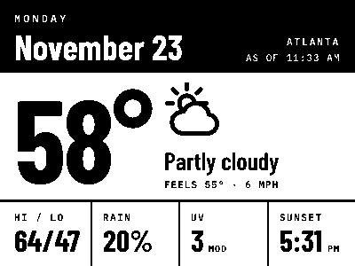

# personal-website

React (CRA) client served by an Express server. UI components are in-house (`client/src/ui`), styled with CSS variables for dark/light themes. Node 22 in Docker (local dev needs Node 20.12+).

## Running locally

```bash
npm --prefix server install && npm --prefix client install
npm --prefix server run startDev   # API on :3002 (reads server/.env)
npm --prefix client start          # UI on :3000, proxies /api to :3002
```

## Environment variables (server)

| Variable | Required | Purpose |
|---|---|---|
| `MONGODB_URI` | for guestbook | Connection string for the `guestbook_app` user. Without it the guestbook returns 503 and the rest of the site works. |
| `MONGODB_DB` | no | Database name. Default `personal_site`. |
| `GUESTBOOK_SECRET` | yes in production | 32+ random characters. Signs form tokens and hashes visitor IPs. Keep it stable: changing it lets past visitors sign again. Generate with `npm --prefix server run gen-secret`. |
| `TRUST_PROXY` | no | Number of reverse proxies in front of the app (default `1`). Must be accurate, or visitors can spoof their IP. |
| `ALLOWED_ORIGINS` | no | Comma-separated origins allowed to call the guestbook API. Default `https://willmarsh.dev,https://www.willmarsh.dev`. |
| `GUESTBOOK_DAILY_CAP` | no | Max new entries across all visitors per 24 h (default `100`). |
| `ADMIN_PASSWORD_HASH` | for admin | Output of `npm --prefix server run hash-password`. Without it (and the secret below) the admin API answers 404. |
| `ADMIN_SESSION_SECRET` | for admin | 32+ random characters for signing admin session cookies. Changing it signs out every session. |
| `PORT` | no | Default `3001`. |

## Feature toggles

Stored in the MongoDB `toggles` collection, one document per feature:

```js
{ _id: "guestbook", enabled: true, updatedAt: ISODate("…") }
```

Documents keyed by `name` or `key` instead of `_id` also work. With no document, a feature uses its default (the guestbook defaults to on). If the database can't be reached, toggled features report as off. Values are cached for 10 seconds. Flip them from `/admin` or directly in MongoDB.

| Toggle | Controls |
|---|---|
| `guestbook` | The guestbook section, the first-visit prompt, the terminal's `guestbook` command, and `/api/guestbook/*` (404 when off). The admin page can still manage entries while it's off. |

## Admin

`/admin` is unlinked and marked `noindex`, but access is enforced by the server, not by the URL staying secret:

- Single password, stored only as a scrypt hash. Logins are limited to 5 failures per IP per 15 min and 30 per hour globally, and every failure takes the same time.
- An 8-hour HttpOnly, `SameSite=Strict` session cookie (`__Host-` prefixed and `Secure` in production), tied to the browser that signed in. Signing out revokes it.
- Same-origin checks on every request. Admin endpoints answer 404 to anything that isn't the site's own UI, or to everyone when admin isn't configured.
- From the admin page you can see all entries (including hidden ones), hide or unhide them, delete them permanently, and see recent activity: blocked requests, filtered messages, new signatures and admin sign-ins. Activity is kept in memory only.

## Guestbook

The guestbook sits at the bottom of the home page (`/#guestbook`; old `/guestbook` links redirect there). First-time visitors get a one-time "want to sign the guestbook?" prompt after dismissing the privacy banner.

- `GET /api/guestbook` lists visible entries, `GET /api/guestbook/session` issues a single-use form token, and `POST /api/guestbook` signs.
- Requests must come from the site's own UI: same-origin `Origin`/`Sec-Fetch-Site`, a custom header, and a signed token bound to the visitor's IP and browser that must be at least 3 s and at most 30 min old.
- One entry per visitor, enforced by a unique index on a hashed IP (IPv6 grouped by /64). Also rate limited, capped per day, with a honeypot field.
- Names and messages are filtered for explicit language (including leetspeak, spacing and invisible-character tricks), links and email addresses, and junk.
- Hide or delete entries from `/admin`.

## E-ink display (`/eink`)

Pages sized for a 400x300 black-and-white e-paper panel (CrowPanel ESP32-S3 4.2"). The panel has no browser, so each page is also served as a 1-bit image. Both come from the same markup, rendered on the server with [satori](https://github.com/vercel/satori) and resvg (no headless browser). Weather is from [Open-Meteo](https://open-meteo.com) (free, no key), cached for 10 minutes.

| URL | What |
|---|---|
| `/eink` or `/eink/today` | HTML preview, exactly 400x300, no JavaScript. `?zoom=2` enlarges it on a desktop screen. |
| `/eink/today.png` | 1-bit PNG, the exact pixels the panel shows. |
| `/eink/today.bmp` | 1-bit BMP, for GxEPD2's `drawBitmapFromWeb`-style examples. |
| `/eink/today.bin` | Raw 15,000-byte frame, row-major, MSB = leftmost pixel, 1 = white. `?invert=1` gives 1 = black for Adafruit GFX `drawBitmap`. |

Optional env vars: `EINK_LAT`, `EINK_LON` (default central Atlanta), `EINK_PLACE` (label, default `Atlanta`), `EINK_TZ` (default `America/New_York`).

Add a panel: create `server/eink/panels/<name>.js` exporting `{id, title, load(), markup(data)}` and list it in `PANELS` in `server/eink/index.js`. Markup must stick to what satori can lay out: inline styles, flexbox only, pure black on white.

### Device



`devices/crowpanel-eink/crowpanel-eink.ino` wakes every 15 minutes, downloads `/eink/today.bin?invert=1`, draws it with GxEPD2 and deep-sleeps. Copy `secrets.example.h` to `secrets.h` for Wi-Fi. A refresh more often than every 10 minutes won't show new weather, and each full refresh flashes the panel.
